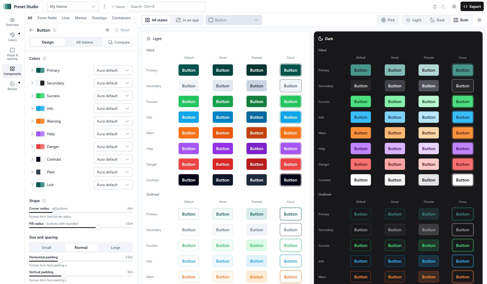

# Preset Studio

A free, open-source visual theme editor for PrimeVue 4. **[presetstudio.vercel.app](https://presetstudio.vercel.app)**

Give it one color. See every component in every state, light and dark, and export a `definePreset` file with only what you changed.



## Why it exists

PrimeVue 5 moved to a proprietary license, and the official Theme Designer now only comes bundled with the paid Commercial Suite. Plenty of apps still run on PrimeVue 4, which is MIT-licensed, and their developers deserve a simple, free way to build presets.

Preset Studio is built only on the last MIT-licensed releases (`primevue` 4.5.5, `@primeuix/themes` 2.0.3, `primeicons` 7.0.0). These are pinned exactly and verified by a license-check script. It shares no code, UI or assets with PrimeTek's commercial products.

## What it does

- **Start fast:** a guided setup (base style, brand color, corners, neutrals) or one of four example themes. Aura, Lara, Nora and Material are the base styles.
- **Look & feel for the whole library:** brand color (22 built-in palettes or any color, with a perceptual 50–950 scale you can fine-tune), neutrals per mode, status colors, text, corner radius, density and the focus ring. Each choice reaches every component of every base style.
- **Shared styles:** form fields, lists, menus, overlays, containers and selection, each edited once for all the components that use it.
- **Every component:** all 88 components' tokens, searchable. Button, Message, Toast, Tag and Badge have visual editors with a stage that shows every variant in every state.
- **A preview you can trust:** your theme renders in its own PrimeVue instance, as stages ("All states") or sample pages ("In an app"), in light, dark or both side by side. Pick anything in the preview to edit it, and see which components a section reaches.
- **Review:** every change listed and revertible on its own; contrast checks in both modes, counting the base style's own failures, with a one-click fix for each.
- **Your workspace:** several themes with undo and redo (kept across reloads), search (⌘K / Ctrl+K), share links and theme files. Everything stays in your browser.
- **Export:** one `definePreset` file with only what you changed, plus the setup for Nuxt or Vue.

## Using the exported preset

The [docs](https://presetstudio.vercel.app/docs) have the details. In short, with Vue:

```ts
import PrimeVue from 'primevue/config'
import MyThemePreset from './themes/my-theme'

app.use(PrimeVue, {
  theme: { preset: MyThemePreset, options: { darkModeSelector: 'system' } },
})
```

With Nuxt and `@primevue/nuxt-module`, `importTheme` must point at a file that exports `{ preset, options }`, not the bare preset; on Nuxt 4 it lives under `app/`.

## Stack

- [Nuxt 4](https://nuxt.com) with TypeScript in strict mode, on Node 24
- PrimeVue 4.5.5 in styled mode, with `@primeuix/themes` 2.0.3
- Pinia for editor state
- Tailwind CSS v4 with `tailwindcss-primeui`
- ESLint (`@nuxt/eslint`) and Vitest
- Deployed on Vercel

## Development

Requires Node 24 (`nvm use`) and pnpm.

```bash
pnpm install          # install dependencies
pnpm dev              # dev server at http://localhost:3000
pnpm lint             # ESLint
pnpm test             # unit tests (Vitest)
pnpm typecheck        # vue-tsc type check
pnpm build            # production build
pnpm license:check    # fail if any PrimeTek package isn't MIT / on a proprietary major
```

### Project layout

```
app/
  pages/          / (landing), /docs, /editor, /preview (only inside the editor's iframe)
  components/     site shell, landing, editor panels and studios, preview pages and stages
  stores/         workspace (saved themes, undo), preset (the theme as a preset), editor (UI)
  composables/    preview linking, spotlight, contrast fixes, …
  utils/theme/    framework-free logic: palettes, resolver, design mapping, export, sharing (+ tests)
public/           favicon, the self-hosted Inter font, landing images
scripts/
  check-licenses.mjs
```

`CLAUDE.md` describes the architecture in detail.

### Dependency policy

Never upgrade `primevue`, `@primevue/*`, `@primeuix/*` or `primeicons` past their pinned versions. Newer majors are proprietary. Dependabot ignores major updates for these packages, and `pnpm license:check` fails if one slips in. New dependencies must be MIT, ISC, BSD or Apache-2.0; the one exception is the Inter font (SIL OFL 1.1).

## Contributing

Bug reports, ideas and pull requests are welcome: see [CONTRIBUTING.md](./CONTRIBUTING.md). Report security problems privately ([SECURITY.md](./SECURITY.md)). Changes are listed in [CHANGELOG.md](./CHANGELOG.md).

## License

[MIT](./LICENSE) © 2026 Moidul Hasan Khan. Third-party notices, including the Inter font, are in [THIRD_PARTY_LICENSES.md](./THIRD_PARTY_LICENSES.md).

## Disclaimer

PrimeVue is a trademark of PrimeTek Informatics. Preset Studio is an independent open-source project and is not affiliated with or endorsed by PrimeTek.
